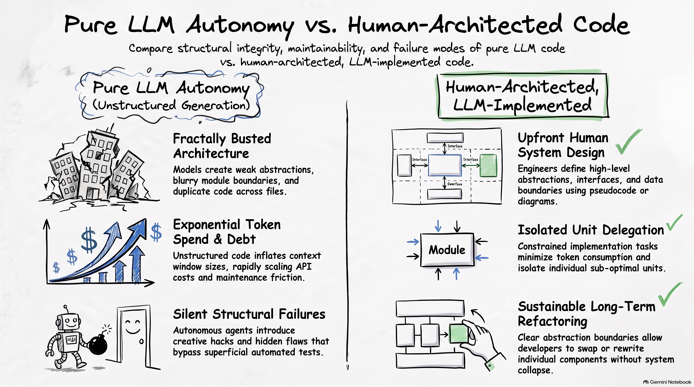

*Modern AI Engineering Practices: Architecture, Delegation, and Quality Assurance in the Agentic Era*

## 1. The Shift in Software Engineering Practices

The integration of generative artificial intelligence and autonomous language model agents into software engineering represents a fundamental shift in development methodology. Development organizations are rapidly transitioning from manual, line-by-line code authoring to directing, orchestrating, and supervising agentic systems.

This evolution introduces a core operational tension across modern engineering teams: balancing the high velocity of automated code generation against the long-term maintainability, structural integrity, and economic sustainability of the codebase. When generative velocity is unconstrained by architectural governance, internal software quality deteriorates rapidly, generating severe structural technical debt.

Synthesizing observations across industry practitioners reveals key paradigm shifts in daily engineering practice:

* **Role Shift from Line Programmer to Managerial Director**: Engineers operate as directors and system architects—defining system boundaries, establishing contract schemas, delegating unit tasks to AI agents, and auditing structural outputs.
* **Architectural Decoupling from Implementation Execution**: Successful teams enforce a strict divide between top-down architectural design—which requires human domain context and system-level abstractions—and bottom-up unit implementation, which is delegated to agents.
* **The Paradigm Divide (YOLO Merge vs. Architectural Discipline)**: Engineering teams are splitting into two distinct operational camps: those who merge AI-written pull requests based on superficial change summaries, and those who enforce strict upfront design boundaries and specification contracts.
* **Operational Effort Reallocation**: Development time is pivoting away from typing syntax, inspecting API documentation, and manual boilerplate generation toward specification authoring, interrogation prompting, schema modeling, and behavioral test validation.
* **Polyglot Scratch Abstraction**: Engineers are leveraging clean, lightweight pseudocode layers (such as Python schemas) to design and iterate on system architectures before instructing AI agents to translate those boundaries into strongly-typed production languages (such as Rust or C++).


## 2. Mitigating Systemic Failure: The "Skeleton vs. Flesh" Architectural Paradigm

### 2.1 Top-Down System Abstraction and Component Hierarchy

Large Language Models (LLMs) consistently fail at high-level architectural abstraction. While models excel at localized logic generation, algorithm optimization, and single-unit completion, they struggle with global context retention, interface design, and component hierarchies. Left to manage system architecture independently, LLM agents fall back on greedy, local hill-climbing optimization: patching code fragments locally to satisfy immediate prompt requirements. This behavior duplicates logic, breaks modular abstractions, and produces unmaintainable software systems.

To mitigate structural decay, engineering methodology must enforce the "Skeleton vs. Flesh" architectural paradigm. Under this model, the human engineer maintains absolute ownership of the "Skeleton"—the top-down system abstraction, actor hierarchies, module interfaces, type contracts, and domain models. The AI agent is restricted to supplying the "Flesh"—filling in execution logic, localized algorithms, and concrete implementation details within those human-designed boundaries.



| | Human Architectural Design ("Skeleton") | AI Unit Implementation ("Flesh") |
|---|---|---|
| **Primary Scope** | System topology, UML-level class hierarchies, component interfaces, actor interaction boundaries, and domain boundaries. | Isolated function bodies, internal control loops, localized algorithmic execution, and concrete method boilerplates. |
| **Key Responsibilities** | Defining strict API contracts, domain model schemas, message passing routes, and behavioral invariants. | Completing unit execution logic within locked function signatures, type bounds, and static parameter contracts. |
| **Failure Mode if Delegated** | Accumulation of structural debt, creation of "big ball of mud" monoliths, interface contract fragmentation, and context window decay. | Localized logic bugs, suboptimal loop performance, or minor syntax errors (easily isolated, corrected, or regenerated). |
| **Long-Term System Impact** | Critical; dictates overall repository maintainability, refactoring safety, and long-term context window efficiency. | Transient; individual unit implementations can be swapped or regenerated without triggering system-wide refactoring. |

### 2.2 Preventing "Fractally Busted" Systems via Scratch Python Schemas

Extended natural-language prompting sessions frequently yield software that is "fractally busted"—a state where compounding errors exist across every structural layer, from single-line syntax bugs up to top-level system interfaces. Natural language is inherently ambiguous; relying on prose prompts leads agents to make invalid structural assumptions across deep call stacks.

To prevent structural drift, engineers use scratch Python specification files as an intermediate pseudocode abstraction layer, regardless of the target application language (e.g., Rust, C++, or Tauri). Python's clean syntax allows engineers to declare structural boundaries precisely without committing to verbose target-language boilerplate.

```python
# scratch_schema.py - System Architecture Contract Specification
# Target Stack: Rust (Tauri Backend) / TypeScript (Frontend IPC)

from typing import Protocol, Dict, Any, Optional
from dataclasses import dataclass

@dataclass(frozen=True)
class UserSession:
    """Invariant: UserSession must be immutable once instantiated."""
    session_id: str
    user_id: str
    auth_token: str

class SecurityTokenVault(Protocol):
    """
    Invariant Rule: Implementations must guarantee atomic read/write access
    to the underlying system keychain. No unencrypted caching permitted.
    """
    def store_token(self, session: UserSession) -> bool:
        """Stores authentication token into system keychain."""
        pass  # Agent to implement platform-specific keychain call in Rust

    def retrieve_token(self, session_id: str) -> Optional[UserSession]:
        """Retrieves active session from vault."""
        ...   # Agent to implement validation and decryption logic

class TelemetryDispatcher:
    def __init__(self, vault: SecurityTokenVault) -> None:
        self.vault = vault

    def dispatch_payload(self, event_name: str, payload: Dict[str, Any]) -> None:
        """
        Invariant Rule: Payload dispatch must abort if SecurityTokenVault
        returns an invalid session state.
        """
        ...   # Agent to complete retry logic, backoff bounds, and Tauri IPC serialization
```

#### Step-by-Step Implementation of Scratch Specification Files:

1. **Establish a Dedicated Scratch Context**: Create a scratch Python file or workspace directory situated alongside the primary production repository.
2. **Model Domain Classes and Data Schemas**: Define domain entities using dataclasses and type annotations, locking down field structures and value constraints.
3. **Declare Explicit Method Signatures and Type Bounds**: Write complete function signatures, parameter type hints, and return types for all public module APIs. Write detailed docstrings defining system invariants and boundary conditions.
4. **Insert Execution Placeholders (`pass` and `...`)**: Place `pass` or Ellipsis (`...`) inside function bodies. This explicitly signals to the agent that execution logic is required while locking down surrounding interface structures.
5. **Execute Polyglot Generation with Context Lockdown**: Direct the AI agent to consume the Python schema and implement or refactor the primary production files (e.g., Rust services) against the schema definition.

### 2.3 Risk-Driven Software Architecture

Modern AI-assisted development adapts George Fairbanks' risk-driven architectural methodology (*Just Enough Software Architecture*). Architectural effort should not be uniformly applied; design investment must scale proportionally to the operational, safety, and financial risks of the target component.

Fairbanks illustrates this concept through the analogy of a civil engineer installing a mailbox: the engineer does not perform structural mechanics calculations, wind load modeling, or deep soil analysis; he simply digs a hole, inserts a post, and pours concrete. Conversely, designing a suspension bridge demands rigorous structural analysis. Modern AI engineering applies this exact proportional risk model:

* **Low-Risk / "Disposable" Components**: UI prototype widgets, internal utility scripts, transient data transformers, or A/B tested feature flags carry minimal structural risk. For these low-risk elements, human engineers can grant AI agents broad autonomy to design both interfaces and execution logic, accepting that unoptimized code can be easily discarded or regenerated.
* **High-Risk / Core Architectural Services**: Core financial transactions, security vaults, state persistence backends, concurrent memory systems, and domain-specific calculation models carry high failure risk. These systems require maximum upfront human architectural investment. Engineers must manually draft class schemas, specify invariant docstrings, and control interface contracts before delegating execution logic to AI agents.

## 3. Operational Workflows and Specification Mechanics

### 3.1 Bi-Directional Agent Sketching and Polyglot Translation

In complex multi-file codebases, engineers employ a bi-directional workflow that combines agentic code extraction with human architectural refinement. This workflow leverages the model's speed in parsing existing source trees while keeping system design under human control.

```text
+-------------------+       1. Extract Architecture       +--------------------+
|  Production App   | ----------------------------------> |   Scratch Python   |
|  (Rust / Tauri)   |                                     |    Schema File     |
+-------------------+                                     +--------------------+
          ^                                                         |
          |                                                         | 2. Human Edits
          | 3. Apply Polyglot Code with                             |    & Lock Down
          |    Compiler Error Feedback Loops                        v    Invariants
          |                                               +--------------------+
          +---------------------------------------------- |  Refined Schema    |
                                                          |  (Signatures Set)  |
                                                          +--------------------+
```

#### Step-by-Step Bi-Directional Workflow Execution:

1. **System Abstraction Extraction**: Instruct the AI agent to analyze a complex, multi-file production module (e.g., a Rust/Tauri backend) and extract a simplified Python schema representation. The agent elides execution details while capturing core classes, signatures, data flows, and state references.
2. **Human Architectural Refinement**: The human engineer reviews the extracted Python schema, restructures modular boundaries, corrects interface flaws, inserts explicit type bounds, and defines strict behavioral invariants.
3. **Polyglot Production Application with Compiler-Driven Loops**: The refined Python schema is provided back to the agent with instructions to propagate the architectural changes across the multi-file production codebase in its target language. The engineer binds the agent to a tight feedback loop with the target language compiler (e.g., `cargo check` or `rustc`), using static compiler errors to automatically guide the agent's implementation back into compliance with the human-designed contract.

### 3.2 Living Specifications, Blueprints, and "Brain Sandwich" Iteration

To prevent agentic drift during feature execution, engineering teams utilize structured artifacts and iterative frameworks that maintain alignment between intent and output.

| Artifact / Framework | Primary Purpose | Impact on AI Generation Quality |
|---|---|---|
| **Markdown Design Documents** | Plain-text documentation capturing functional scope, system non-goals, architectural decisions, and phased milestones. | Establishes a persistent context anchor across multi-turn sessions; reduces off-target generation and hallucinated features. |
| **PlantUML Component Diagrams** | Text-based diagramming defining sequence flows, actor interactions, state machines, and system relationships. | Forces the LLM to process sequence logic, state transitions, and object relationships structurally before generating code. |
| **Bootstrap Specification Files** | Structured rule definitions establishing project directory layouts, dependency bounds, and language style constraints. | Prevents agents from introducing arbitrary directory layouts, unvetted third-party libraries, or non-standard code patterns. |
| **"Brain Sandwich" Framework** | A three-phase execution model: Upfront Human System Design → Automated AI Execution → Human Code Audit & Behavioral Verification. | Prevents architectural degradation by inserting human technical judgment at critical decision boundaries. |

### 3.3 Interrogation Prompting and Probing Techniques

Rather than passively accepting generated code or using generic prompts like "fix this bug," experienced engineers apply active oversight using interrogation prompts. Probing model decisions reveals edge-case assumptions, missing abstractions, and silent flaws before code reaches production.

#### Interrogation Prompts and Operational Mechanics:

* *Prompt*: **"Why didn't you choose design pattern X for this specific problem, and what trade-offs are implicit in your approach?"**
  * **Off-Target Model Output**: The agent generates a monolithic function with inline state mutation, ignoring modular extensibility.
  * **Corrected Architectural Adjustment**: The interrogation forces the agent to analyze alternative patterns. The model admits it chose a naive approach to minimize code length, refactoring the solution into a Strategy Pattern that cleanly isolates state modifications.
* *Prompt*: **"What implicit assumptions are made in this data model regarding concurrency, state persistence, and memory locks?"**
  * **Off-Target Model Output**: The agent writes a thread-unsafe static map, assuming single-threaded execution in an asynchronous runtime.
  * **Corrected Architectural Adjustment**: The agent identifies thread-safety risks in multi-threaded environments, wrapping data access in explicit read-write locks (`RwLock`) and introducing atomic transaction bounds.
* *Prompt*: **"How does this implementation behave under memory pressure or network latency edge cases?"**
  * **Off-Target Model Output**: The agent omits connection timeouts and error handling, leaving API calls hanging indefinitely on network failure.
  * **Corrected Architectural Adjustment**: The model adds timeout bounds, explicit exception wrapping, and exponential backoff retry policies.
* *Prompt*: **Systematic Instruction Gap Closing**:
  * **Operational Execution**: When an engineer uncovers a recurring error pattern during code reviews, they convert the corrective guidance into a permanent constraint rule inside the workspace rule file (e.g., `.cursorrules` or system prompts), permanently closing the instruction gap.

---

## 4. Role Evolution: The Engineer as Agent Manager

### 4.1 Transitioning from Line Programmer to Principal Engineer Director

AI coding tools democratize the operating model historically reserved for Principal Engineers (PEs). In traditional engineering organizations, senior architects design system boundaries and delegate unit implementation to junior developers, auditing pull requests to ensure alignment. Modern AI workflows allow engineers at any level to operate in a similar directive capacity—delegating implementation to AI agents while focusing human cognitive effort on system abstraction, contract definition, and verification.

| | Traditional Software Developer Role | Emerging "Agent Manager" Role |
|---|---|---|
| **Primary Output** | Hand-written syntax, manual line-by-line function authoring, and localized component debugging. | System design blueprints, scratch Python schemas, behavioral test suites, and prompt constraints. |
| **Core Skillset** | Language syntax fluency, typing speed, local stack-trace debugging, and API parameter memorization. | System boundary abstraction, contract definition, interrogation prompting, and behavioral verification. |
| **Task Execution** | Pulls JIRA tickets to write code implementation units line-by-line. | Directs multiple AI agents to execute implementation units concurrently across abstract schemas. |
| **Codebase Mental Model** | Micro-level mental model of manually typed syntax, local variables, and inline execution loops. | Macro-level mental model of component interactions, contract interfaces, and invariant boundaries. |
| **Quality Control Method** | Manual unit test writing, line-by-line syntax inspection, and manual peer code reviews. | Interactive sandbox testing, compiler-driven error feedback loops, static slop detection, and automated test validation. |

### 4.2 Cultural and Psychological Impacts Across Engineering Levels

The transition to agentic engineering has created psychological and cultural friction across the industry, revealing contrasting perspectives on craftsmanship, professional fulfillment, and career sustainability:

* **Alienation and the Loss of Craftsmanship**: A senior engineer with 10 years of experience, patent holdings, and a background at a tech unicorn described profound burnout and loss of professional identity resulting from the deluge of AI-generated pull requests. Experiencing a diminished sense of satisfaction from no longer directly solving complex technical problems, and facing organizational pressure to approve unreviewed PRs, this practitioner actively considered leaving the tech industry entirely to train as a hydroelectric dam electrician in Norway.
* **Domain Shift and Linguistic Disconnects**: Illustrating the communication breakdown in the LLM era, a senior engineer failed a third-round technical interview when asked about "NLP." The candidate laughed, assuming the interviewer was referring to "Natural Language Programming" via LLM prompts, whereas the interviewer was asking a serious question about classical Natural Language Processing. The resulting disconnect highlighted how modern generative tool usage can create blind spots around foundational computer science domain knowledge.
* **Corporate Incentive Alignment and Technical Debt**: Industry practitioners point out that corporate incentive structures frequently discourage long-term code quality. Software engineers are financially incentivized to quickly ship superficial features that satisfy external product management criteria, add the project as a resume accomplishment, and transition to higher-compensated roles within two years—long before the internal technical debt and architectural decay cause operational strain.
* **Autonomy and the Solo Craftsman**: Conversely, a veteran developer described living frugally off savings while leveraging AI agents as force multipliers to build complex products independently. This developer characterized the current era as "the best of times" for solo builders, allowing small teams or individuals to ship ambitious, high-quality software without corporate overhead.
* **Career Pivot Away from Tech**: Multiple software developers reported leaving corporate engineering entirely to pursue alternative professions, such as completing pre-medical coursework for healthcare careers (e.g., Physician Assistant programs or Medical Physics), finding the process of remaining competitive in an LLM-driven job market less appealing than transitioning into human-centered fields.

## 5. Verification, Quality Assurance, and Defect Detection

### 5.1 Reallocation of Engineering Time to Rigorous Testing

Because AI agents reduce the time required to write boilerplate syntax, engineering teams reallocate saved development hours into rigorous, interactive testing and behavioral validation. Defect detection strategies are pivoting away from manual syntax inspection toward robust runtime verification.

* **Interactive LLM Validation Sessions**: Engineers execute real-time, interactive testing sessions alongside the agent—running generated code in isolated sandbox environments, feeding runtime error traces back into the prompt context, and dynamically probing boundary conditions.
* **Test-Driven Constraint Boundaries**: Drafting strict unit test suites and behavioral invariant assertions *before* initiating AI code generation. The agent is tasked with passing the test suite, making verification an objective, automated process.
* **Behavioral Verification over Line Inspection**: Peer reviews focus on evaluating test coverage and behavioral assertions rather than manually inspecting boilerplate lines. Reviewers verify *what* the system accomplishes rather than debating *how* the lines were typed.
* **Early Essential Complexity Discovery**: Rapid prototyping via AI allows engineers to surface hidden domain edge cases early in the design cycle, adapting test suites to cover subtle failure modes prior to committing to production architecture.

### 5.2 Multi-Agent Verification, Slop Detection, and Context Retention Tools

To combat codebase degradation caused by agentic generation, engineering organizations are adopting specialized verification tools and context-retention mechanisms.

* **Automated "Slop" Detectors**: Static analysis tooling configured to identify unmaintainable AI code patterns—such as duplicated logic blocks, overly verbose function signatures, unused variables, and unnecessary abstraction layers—flagging them for refactoring prior to merge.
* **Voice-Narrated Walkthrough Tools**: Developers build custom context-retention utilities (such as PR-to-speech narration scripts) that parse complex pull requests and generate structured audio walkthroughs. This allows engineers to maintain high-level mental models of agent-written logic without reading thousands of lines of boilerplate.
* **Closed-Loop Execution Environments**: Continuous integration setups that allow agents to autonomously execute test suites, parse compiler diagnostic outputs, correct build errors, and resolve failing assertions in a closed loop before presenting code for human review.

#### Case Study: Domain-Specific Blind Spots in Specialized Code Bases

A clear example of the limitations of automated verification occurs in specialized mathematical and scientific codebases. During the generation of a fluid dynamics simulation using the D2Q9 Lattice Boltzmann Method (LBM) in C++, an AI agent produced the following syntax-valid array constants:

```cpp
// AI-Generated Lattice Boltzmann Method (D2Q9 Model) Constants
static constexpr std::array<int, Q> cx{0, 1, 0, -1, 0, 1, -1, -1, 1};
static constexpr std::array<int, Q> cy{0, 0, 1, 0, -1, 1, 1, -1, -1};
static constexpr std::array<real_t, Q> w{ real_t(4) / 9, real_t(1) / 9, real_t(1) / 9, real_t(1) / 9, real_t(1) / 9, real_t(1) / 36, real_t(1) / 36, real_t(1) / 36, real_t(1) / 36};
static constexpr std::array<int, Q> opp{0, 3, 4, 1, 2, 7, 8, 5, 6};
```

While the C++ compiler confirms perfect syntax and static type safety, a non-specialist human engineer cannot visually verify the mathematical correctness of these lattice weights (`w`) or directional vectors (`cx`, `cy`) without deep domain knowledge. In this instance, a domain specialist recognized the LBM constants immediately, confirming their accuracy. However, this case study highlights a critical risk: AI coding agents generate syntax-valid, compiling code that can conceal subtle mathematical or domain-specific errors. Without rigorous domain-specific test suites or expert human review, these latent errors bypass conventional static analysis and unit tests.

## 6. Economic Trade-offs: Technical Debt, Token Budgets, and the Maintainability Debate

### 6.1 The "YOLO Merge" Paradigm vs. Architectural Discipline

The software industry has split into two competing operational philosophies regarding AI-generated code governance: the **"YOLO Merge" School** and the **"Architectural Discipline" School**.

```text
                         ENGINEERING PHILOSOPHIES
                                    |
             +----------------------+----------------------+
             |                                             |
             v                                             v
    "YOLO MERGE" SCHOOL                  "ARCHITECTURAL DISCIPLINE" SCHOOL
 - Merge based on PR titles           - Enforce human-led architectural
   & summaries.                         designs.
 - Expect future models to            - Use scratch Python schemas
   refactor slop.                       & UML contracts.
 - Prioritize immediate               - Treat internal code structure
   feature velocity.                    as vital asset.
```

| Evaluation Parameter | "YOLO Merge" School | "Architectural Discipline" School |
|---|---|---|
| **Core Philosophy** | Short-term feature delivery takes priority over internal maintainability. Teams assume future models (e.g., "Fable 6") will autonomously refactor legacy AI "slop." | Internal software quality must be actively preserved. Unguided AI generation creates compounding structural debt that degrades long-term engineering productivity. |
| **Development Velocity** | Maximum short-term velocity. Pull requests are merged rapidly based on high-level descriptions and basic behavioral checks. | Balanced velocity. Upfront schema planning adds initial overhead, offset by lower refactoring costs later in the development cycle. |
| **Long-Term Cost Profile** | Escalating long-term costs. Unstructured codebases increase context window bloat, driving up token spend for future development tasks. | Predictable, optimized token spend. Clean abstractions keep context windows small and focused during agent prompts. |
| **System Reliability** | Higher risk of latent logic flaws, circular dependencies, edge-case failures, and architectural degradation over time. | High system reliability. Strict adherence to contract interfaces, invariants, and comprehensive test suites minimizes defects. |
| **Risk Profile** | High exposure to technical debt if model capability gains plateau, or if enterprise token budgets face strict financial accounting. | Low operational risk. The codebase remains readable, modular, and maintainable by human engineers and AI agents alike. |

### 6.2 Token Economics, Context Window Bloat, and Internal vs. External Quality

Neglecting internal software quality (clean architecture, modular abstractions, readable directory structures) to maximize short-term external quality (visible user features) creates a financial trap in agentic workflows. This operational trade-off directly connects to the classic distinction formalized by **Freeman & Pryce (2009)** in *Growing Object-Oriented Software, Guided by Tests*: **external quality** measures how well a system meets functional user requirements, whereas **internal quality** measures how easily the software can be modified, understood, and maintained.

When internal quality is neglected and an AI-assisted codebase degenerates into unstructured "slop," AI agents require increasingly larger context windows to navigate system state. This dynamic uncovers a critical economic reality: **the Vendor Pit Trap**.

```text
+-----------------------------------------------------------------------+
|                         THE VENDOR PIT TRAP                           |
|                                                                       |
|  Model vendors (e.g., OpenAI, Anthropic) operate with internal        |
|  models and unlimited token spend, demonstrating agents managing      |
|  massive, unstructured codebases.                                     |
|                                                                       |
|  ENTERPRISE REALITY: Enterprises operate on finite token budgets.     |
|  Unstructured codebases bloat context windows, exponentially          |
|  inflating API costs and reducing model reasoning performance.        |
+-----------------------------------------------------------------------+
```

As detailed by industry practitioners, model vendors operate with internal model access and effectively unlimited compute budgets, demonstrating agents autonomously maintaining massive, unstructured repositories. This sets a "pit trap" for enterprises. When organizations adopt unguided AI generation without architectural governance, their codebases suffer from severe context bloat, resulting in three major operational penalties:

1. **Escalating Inference Spend**: Processing bloated context windows across hundreds of daily agent passes inflates enterprise API token bills.
2. **Degraded Model Reasoning**: LLMs operating over messy context windows experience reduced reasoning accuracy, lose focus on subtle instructions, and make frequent off-target code edits.
3. **Compounding Refactoring Costs**: To fix bugs in a messy codebase, agents apply localized patches rather than clean refactors, accelerating architectural decay.

#### Actionable Recommendations for Engineering Leadership:

1. **Mandate Human Ownership of Top-Level Architecture**: Require senior engineers to design and approve component topologies, module contracts, and domain schemas before initiating AI generation.
2. **Standardize Scratch Schema Workflows**: Integrate lightweight scratch Python specification files using `pass` and `Ellipsis` (`...`) into standard pull request planning phases to establish clear implementation boundaries.
3. **Deploy Automated Slop Detection in CI/CD Pipelines**: Implement static analysis and slop detection tools to catch code duplication, unnecessary abstraction layers, and context bloat before code is merged.
4. **Shift Code Review Metrics to Behavioral Validation**: Reallocate code review criteria away from manual syntax inspection toward automated test suite execution, invariant verification, and interactive runtime testing.
5. **Enforce Proportional Risk-Driven Architectural Governance**: Scale architectural effort proportionally to operational risk—permitting rapid agent autonomy for low-risk, disposable utilities while enforcing strict schema contracts and human oversight for core mission-critical services.
